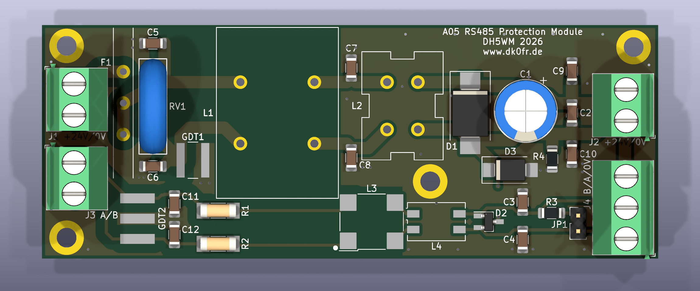

# RS485 Protection Module

Überspannungs- und HF-Schutzmodul für RS485 und 24 V am Antennenrotor von DK0FR (DOK A05), DH5WM 2026, www.dk0fr.de

Das Modul sitzt hinter dem NEMA-17-Rotormotor in einem geerdeten Vierkantrohr. Es schützt Motor und Treiber vor zwei Dingen:

- Überspannungen, die bei Gewittern in die 30 m lange, ungeschirmte Steuerleitung einkoppeln
- HF-Einstreuung (1,8–30 MHz, bis 750 W) aus den benachbarten KW-Antennen

Jeder Pfad (24 V und RS485) durchläuft vier Stufen:

1. Ringkern
2. Grobschutz mit Gasableiter und Varistor
3. zweistufiger Gleichtaktfilter
4. TVS-Feinschutz

**Stand:** Rev. 4 vom 15.10.2026. Die Platine ist geroutet und gegen die Datenblätter geprüft, die Gerberdaten sind bestellfertig. Die Schaltung ist berechnet, aber noch nicht gemessen.

## Eckdaten

| | |
|---|---|
| Versorgung | 24 V DC (Netzteil ≤ 24,5 V), ausgelegt für 5 A, PTC 8 A |
| Bus | RS485 2-Draht, bis 115 200 Bd, Abschluss 120 Ω per Steckbrücke |
| Schutz | GDT 90 V, Varistor S14K30, SMCJ26A, SM712, Gleichtaktdrosseln 1 mH/32 µH und 2,2 mH/51 µH |
| Platine | 100 × 38 mm, 2 Lagen, 1,6 mm, 4 × M3 (PE ans Rohr) |

## Dokumentation

Die vollständige Dokumentation steht in **[doc/README.md](doc/README.md)**:

- [Schaltung](doc/README.md#3-schaltung) mit Schaltbildern für 24 V und RS485 und [Auslegung](doc/README.md#4-auslegung-und-entscheidungen)
- [Platine](doc/README.md#5-platine): Bestückungsplan, Layout, PE-Konzept, Drosselwicklungen, Netzklassen
- [Einbau und Anschluss](doc/README.md#6-einbau-und-anschluss) mit Klemmenbelegung
- [Stückliste](doc/README.md#7-stückliste) und [Leiterplatte bestellen](doc/README.md#8-leiterplatte-bestellen)
- [Bestückung](doc/README.md#9-bestückung) und [Prüfung und Inbetriebnahme](doc/README.md#10-prüfung-und-inbetriebnahme)
- [Prüfstand](doc/README.md#11-prüfstand-des-entwurfs) und [offene Punkte](doc/README.md#12-offene-punkte)

## Dateien

| Datei | Inhalt |
|---|---|
| [`rs485-protection-module.kicad_pro`](rs485-protection-module.kicad_pro), [`.kicad_sch`](rs485-protection-module.kicad_sch), [`.kicad_pcb`](rs485-protection-module.kicad_pcb) | KiCad-10-Projekt |
| [`doc/schaltplan.pdf`](doc/schaltplan.pdf) | Schaltplan als PDF |
| [`Fertigung/JLCPCB_Rev4/rs485-protection-module_Rev4_JLCPCB.zip`](Fertigung/JLCPCB_Rev4/rs485-protection-module_Rev4_JLCPCB.zip) | Gerber- und Bohrdaten für JLCPCB |
| [`Mouser-Bestellliste-Rotor-Schutzmodul (1).xlsx`](<Mouser-Bestellliste-Rotor-Schutzmodul (1).xlsx>) | Bestellliste für den Mouser-BOM-Import |
| [`doc/`](doc/) | Dokumentation und Abbildungen |

Repository: https://github.com/DK0FR/rs485-protection-module
