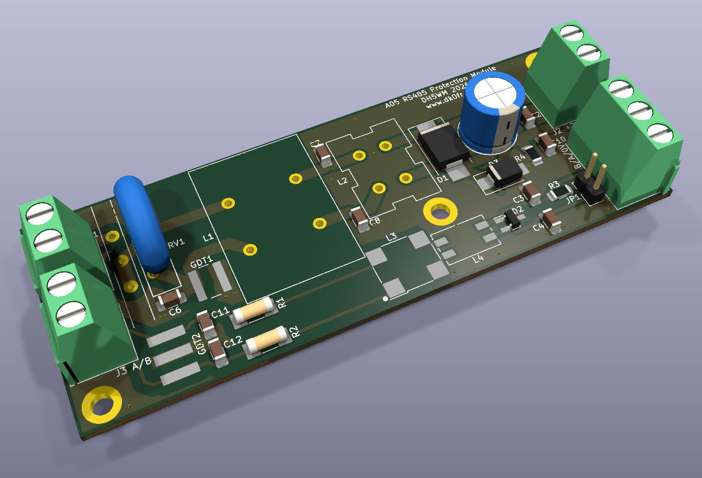
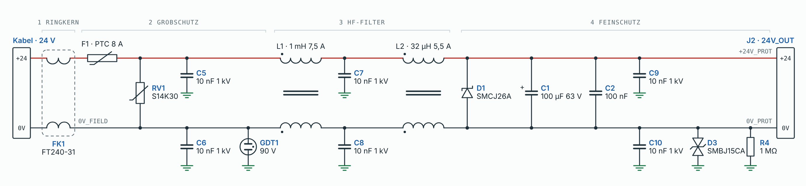
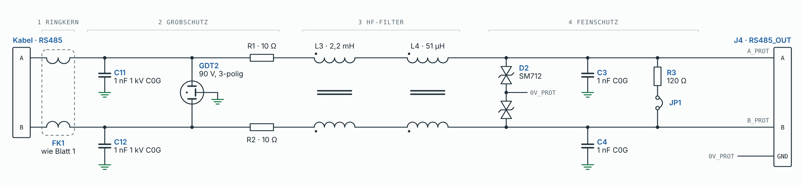
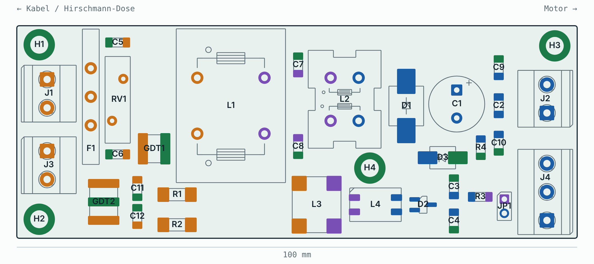
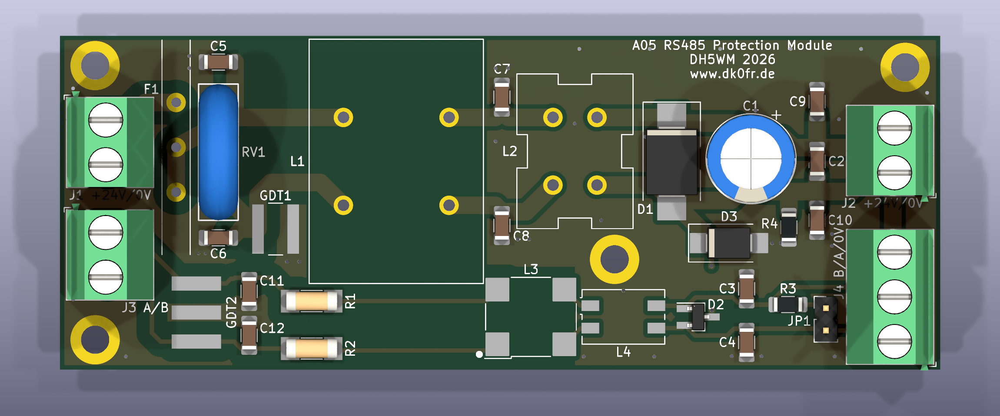
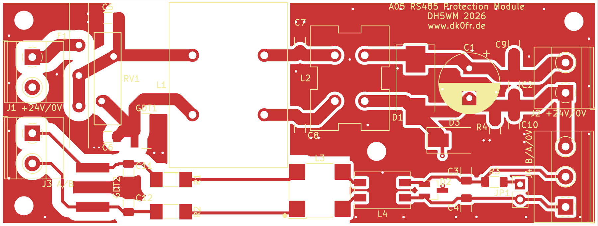
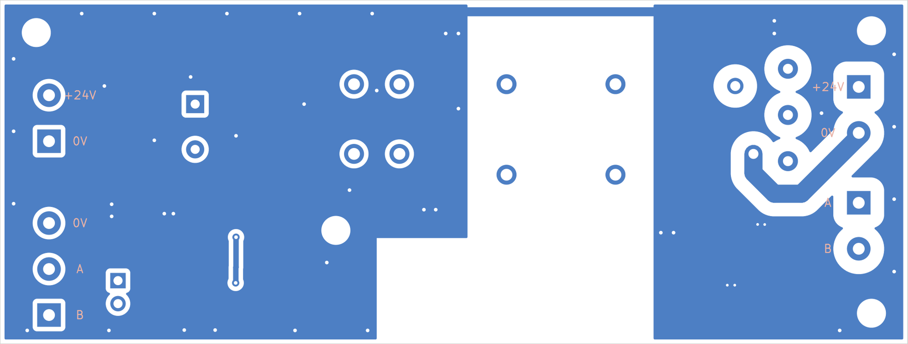
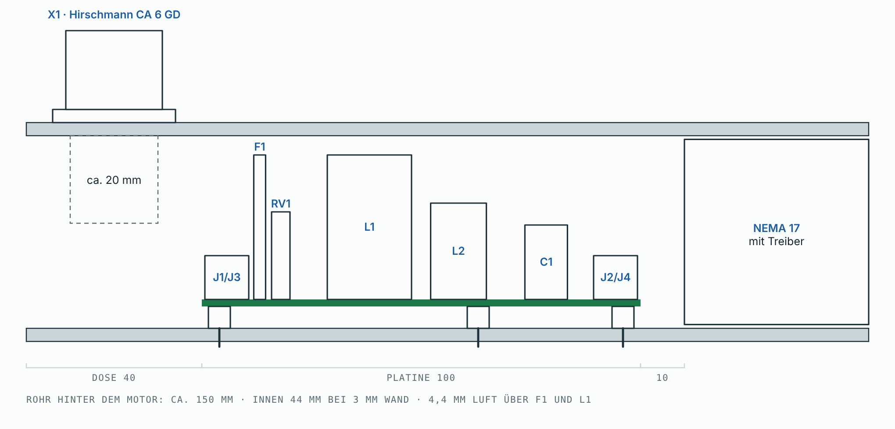

# RS485 Protection Module – Dokumentation

Überspannungs- und HF-Schutzmodul für RS485 und 24 V am Antennenrotor von DK0FR (DOK A05).
Aufdruck auf der Platine: „A05 RS485 Protection Module / DH5WM 2026 / www.dk0fr.de“.

Stand: 15. Oktober 2026, Rev. 4. Die Platine ist geroutet und geprüft, die Gerberdaten sind bestellfertig. Die Schaltung ist berechnet, aber noch nicht gemessen.

## Inhalt

1. [Aufgabe](#1-aufgabe)
2. [Technische Daten](#2-technische-daten)
3. [Schaltung](#3-schaltung)
4. [Auslegung und Entscheidungen](#4-auslegung-und-entscheidungen)
5. [Platine](#5-platine)
6. [Einbau und Anschluss](#6-einbau-und-anschluss)
7. [Stückliste](#7-stückliste)
8. [Leiterplatte bestellen](#8-leiterplatte-bestellen)
9. [Bestückung](#9-bestückung)
10. [Prüfung und Inbetriebnahme](#10-prüfung-und-inbetriebnahme)
11. [Prüfstand des Entwurfs](#11-prüfstand-des-entwurfs)
12. [Offene Punkte](#12-offene-punkte)
13. [Dateien und Versionen](#13-dateien-und-versionen)

## 1. Aufgabe

Ein Schrittmotor NEMA 17 mit integriertem Treiber dreht den Antennenrotor. Die Daten des Treibers sind unbekannt. Der Motor hängt an 30 m ungeschirmter Steuerleitung mit 24 V DC und RS485 (2-Draht, bis 115 200 Bd). In der Nähe stehen KW-Antennen mit bis zu 750 W Sendeleistung.

Das Modul sitzt direkt am Motor und schützt ihn vor zwei Dingen:

- **eingekoppelten Überspannungen** bei Gewittern in der Nähe (kein Direkteinschlag)
- **HF-Einstreuung** von 1,8 bis 30 MHz beim eigenen Sendebetrieb

## 2. Technische Daten

| Größe | Wert |
|---|---|
| Versorgung | 24 V DC, Netzteil auf höchstens 24,5 V einstellen |
| Dauerstrom | ausgelegt für 5 A (Bahnen 2 mm, 1 oz, ≈ 17 K Erwärmung); PTC hält 8 A, löst ab ≈ 16 A aus |
| Klemmspannung 24 V | SMCJ26A, 26 V Arbeitsspannung |
| Datenleitung | RS485, 2-Draht, bis 115 200 Bd, Signalpegel am Abschluss ≈ 86 % |
| Gleichtaktdämpfung | Ziel 2–5 kΩ über 1,8–30 MHz (Ringkern + zwei Drosselstufen je Pfad) |
| Ableiter | Gasableiter 90 V gegen PE, Varistor S14K30 zwischen +24 V und 0 V |
| Bezugspotenzial | 0 V nicht fest geerdet: über 10 nF, SMBJ15CA und 1 MΩ an PE |
| Platine | 100 × 38 mm, 2 Lagen, 1,6 mm, 36 Bauteile |
| Bauhöhe | max. 33 mm (L1, F1), 4,4 mm Luft zur Rohrwand |
| Befestigung | 4 × M3 mit Metall-Abstandshaltern 5 mm, zugleich PE-Anbindung ans Rohr |

## 3. Schaltung

Beide Pfade sind gleich aufgebaut, in vier Stufen von der Kabelseite zum Motor:

1. **Ringkern** außerhalb der Platine
2. **Grobschutz** gegen Überspannung
3. **HF-Filter** mit zwei Gleichtaktdrosseln
4. **Feinschutz** mit TVS-Dioden

Der KiCad-Schaltplan liegt als [schaltplan.pdf](schaltplan.pdf) bei, das Original ist [`../rs485-protection-module.kicad_sch`](../rs485-protection-module.kicad_sch).

### 3.1 Versorgung 24 V

Signalweg vom Kabel zum Motor:

| Stufe | Bauteile | Aufgabe |
|---|---|---|
| Ringkern | FK1 FT240-31, 12 Windungen, alle vier Adern | erste Gleichtaktsperre, besonders bei 1,8–7 MHz |
| Grobschutz | F1 PTC MF-R800 | trennt bei Dauerkurzschluss (ab ≈ 16 A) |
| | RV1 S14K30 zwischen +24 V und 0 V | begrenzt energiereiche Gegentakt-Überspannung |
| | C5, C6 10 nF/1 kV je Ader nach PE | leiten HF ab, bevor sie den Gasableiter zünden kann |
| | GDT1 90 V zwischen 0 V und PE | leitet Gleichtakt-Überspannung ins Rohr |
| HF-Filter | L1 1 mH/7,5 A (MnZn) → C7, C8 10 nF nach PE → L2 32 µH/5,5 A (NiZn) | Gleichtaktsperre für tiefe und hohe KW-Frequenzen, Kondensatoren dazwischen gegen Resonanz |
| Feinschutz | D1 SMCJ26A, C1 100 µF, C2 100 nF, C9, C10 10 nF nach PE | Restspannung begrenzen, puffern, letzte HF-Ableitung |
| 0-V-Bezug | D3 SMBJ15CA, R4 1 MΩ, C10 | 0 V schwimmt gegenüber PE, ist aber begrenzt und entladen |

### 3.2 RS485

| Stufe | Bauteile | Aufgabe |
|---|---|---|
| Ringkern | FK1, gemeinsam mit den 24-V-Adern | siehe oben |
| Grobschutz | C11, C12 1 nF/1 kV C0G nach PE | leiten HF ab, schützen GDT2 vor Zündung beim Senden |
| | GDT2 90 V, 3-polig (A, B gegen PE) | leitet Überspannung beider Adern gleichzeitig ab |
| | R1, R2 10 Ω Kohleschicht-MELF | entkoppeln Grob- und Feinschutz, impulsfest |
| HF-Filter | L3 2,2 mH (WE-SL5) → L4 51 µH (WE-SL2) | Gleichtaktsperre, zweistufig |
| Feinschutz | D2 SM712 (A, B gegen 0 V), C3, C4 1 nF nach PE | asymmetrische Klemmung −7/+12 V passend zu RS485 |
| Abschluss | R3 120 Ω mit Steckbrücke JP1 | nur stecken, wenn das Modul am Busende sitzt und der Motortreiber keinen eigenen Abschluss hat |

> **Hinweis zu den Schaltbildern:** Die beiden Bilder sind Übersichtsdarstellungen aus der Planung. Maßgeblich für Pinnummern ist der KiCad-Schaltplan, besonders bei L3 (siehe [5.4](#54-drosselwicklungen)).

## 4. Auslegung und Entscheidungen

- **Dreistufige Gleichtaktsperre** aus Ringkern, MnZn-Drossel und NiZn-Drossel: Eine einzelne 51-µH-Drossel bringt bei 1,8 MHz nur rund 580 Ω. Ziel sind 2–5 kΩ über das ganze KW-Band.
- **Kondensatoren nach PE vor den Gasableitern:** Ohne sie könnte die HF-Spannung beim Senden die 90-V-Ableiter zünden. Die Kondensatoren zwischen den Drosselstufen dämpfen Resonanzen.
- **Kein Gasableiter an +24 V:** Seine Bogenspannung liegt unter 24 V, er würde am Netzteil nicht wieder löschen. Deshalb liegt ein Varistor zwischen +24 V und 0 V, und der Gasableiter sitzt nur zwischen 0 V und PE.
- **SMCJ26A** ist die engste sinnvolle Klemmung, solange die Spannungsgrenze des Treibers unbekannt ist. Daraus folgt: Netzteil auf höchstens 24,5 V stellen.
- **PTC-Sicherung MF-R800 (8 A)** statt Feinsicherung (auf Wunsch, seit Rev. 3), selbstrückstellend. 8 A wegen Derating im warmen Rohr. Sie löst erst ab ≈ 16 A aus und schützt also nur mit einem kräftigen Netzteil.
- **10 Ω statt 47 Ω** in den RS485-Adern: Der Signalpegel am Abschluss bleibt bei ≈ 86 %. Impulsfeste Kohleschicht-MELF statt 0,25-W-Typen.
- **0 V nicht fest geerdet:** Wäre 0 V am Modul mit PE verbunden und zusätzlich am Netzteil geerdet, flösse Gleichstrom über die Erde und L1 könnte sättigen.
- **Eigene Leiterplatte** statt des ursprünglichen Lochraster-Aufbaus (bis Rev. 3). Der SOT-23-Adapter für D2 entfällt. Alle SMD-Bauteile haben Handlöt-Pads.

## 5. Platine

### 5.1 Bestückungsplan

Links Kabelseite (Hirschmann-Dose), rechts Motorseite. Die Farben zeigen die Zonen: orange ist kabelseitig (ungeschützt), violett liegt zwischen den Drosselstufen, blau ist geschützt, grün ist PE.

> Der Bestückungsplan zeigt den Planungsstand vor dem Routing. Der aktuelle Stand weicht in Details ab: L3 ist um 90° gedreht, die GDT1-Pads sind schmaler, und die Beschriftung hat sich geändert. Maßgeblich sind die Ansichten in 5.2.

### 5.2 Layout

Oberseite in 3D, wie sie bei JLCPCB gefertigt und bestückt wird:

Für L1, L2, F1, GDT1, GDT2 und L3 gibt es in KiCad keine 3D-Modelle. Sie fehlen in den 3D-Ansichten, ihre Lötflächen sind aber vorhanden.

Kupfer und Bestückungsdruck oben:

Unterseite, gespiegelt (also so, wie man von unten auf die Platine schaut):

### 5.3 PE-Konzept

- **Zwei getrennte PE-Flächen auf beiden Lagen:**
  - PE_EIN auf der Kabelseite (x 100–128 mm) mit den Befestigungslöchern H1/H2
  - PE_AUS auf der geschützten Seite (ab x 148,5 mm, im unteren Bereich ab 158,5 mm) mit H3/H4
- **Kein Kupfer unter L1 und L3:** Sonst würde der Spannungsabfall über die PE-Kupferfläche die erste Drosselstufe umgehen.
- **Verbindung der Flächen** nur über eine 1-mm-Brücke am oberen Rand und über das Rohr. Der Stoßstrom fließt so auf kürzestem Weg über die linken Abstandshalter ins Rohr, nicht quer über die Platine.
- **Anbindung:** Pads vollflächig angebunden, Verbindungs-Vias etwa alle 8 mm, Via-Paare an jedem PE-Kondensator.
- **Keine 0-V-Fläche,** weil 0 V bewusst nicht fest mit PE verbunden ist.

### 5.4 Drosselwicklungen

Die Wicklungen sind aus den Würth-Datenblättern bestimmt, nicht gemessen.

| Drossel | Würth-Wicklungen | Phasenpunkte | Umsetzung |
|---|---|---|---|
| L1 744824801, L2 744842632 | 1–4 und 2–3 | 1, 2 | Footprint-Nummern weichen von Würth ab (1–2 / 4–3), die Lage der Wicklungen stimmt aber. Die Drosseln lassen sich nicht falsch einsetzen. |
| L3 744272222 (WE-SL5) | 1–2 und 4–3 | 1, 4 | Eigenes Symbol CMC_SL5 mit Würth-Nummern: A_R→4, A_MID→3, B_R→1, B_MID→2. Footprint um 90° gedreht. Der Punkt im Bestückungsdruck links unten markiert Würth-Pin 1. |
| L4 744227 (WE-SL2) | 1–4 und 2–3 | 1, 2 | Symbol CMC_SL, passt. |

### 5.5 Netzklassen und Regeln

| Netzklasse | Netze | Bahnbreite | Abstand |
|---|---|---|---|
| Feld_24V | +24V_IN, +24V_FIELD, 0V_FIELD | 2 mm | 1,5 mm |
| Feld_RS485 | A_FIELD, B_FIELD, A_R, B_R | 0,5 mm | 1,5 mm |
| Leistung_24V | +24V_MID, 0V_MID, +24V_PROT, 0V_PROT | 2 mm | 0,5 mm |
| RS485 | A_MID, B_MID, A_PROT, B_PROT, TERM | 0,5 mm | 0,3 mm |
| PE | PE_CHASSIS | 1 mm | 0,3 mm |

- Die Muster beginnen mit „*“, damit sie auch auf die Schaltplan-Netznamen mit „/“ passen.
- Die internen Netze sind benannt, damit die Zuordnung ein Netzlisten-Update übersteht.
- Ein Abstand von 2 mm auf der Kabelseite hätte an den 1206-Pads nicht gepasst, daher 1,5 mm.

### 5.6 Bestückungsdruck

- Alle Texte 1,0 mm hoch, 0,15 mm Strichstärke (JLCPCB-Minimum), ohne Überlappung mit Pads oder Gehäusen.
- Klemmen-Legenden statt J1–J4, in Pin-Reihenfolge von oben nach unten: „J1 +24V/0V“, „J3 A/B“, „J2 +24V/0V“. „J4 B/A/0V“ steht senkrecht und wird von unten gelesen. Auf der Unterseite ist jeder Klemmenpin einzeln beschriftet.
- Polaritäten: C1 „+“, Kathodenstrich bei D1, Pin-1-Markierung bei D2, Punkt für den Wicklungsanfang bei L3.

## 6. Einbau und Anschluss

Motor und Modul sitzen in einem geerdeten Vierkantrohr 50 × 50 mm. Das Modul liegt hinter dem Motor. Die Steuerleitung kommt über eine Hirschmann-Dose CA 6 GD (6 + PE) seitlich ins Rohr.

- **Platzbedarf:** Hinter dem Motor sind etwa 150 mm Rohr: 10 mm Luft, 100 mm Platine, 40 mm für die Dose. Die 40 mm und die Wandstärke von 3 mm sind geschätzt, siehe [offene Punkte](#12-offene-punkte).
- **Befestigung:** Vier M3-Schrauben mit Metall-Abstandshaltern (5 mm). Sie verbinden PE mit dem Rohr und müssen deshalb blank aufliegen, ohne Lack und ohne Isolierscheibe.
- **Isolation:** Zwischen Platinenunterseite und Rohrwand kommt Isolierfolie, ausgespart an den Abstandshaltern.
- **Klemmen:** Die Kabeleinführungen zeigen nach außen, bei J1 und J3 zur Dose, bei J2 und J4 zum Motor.

**Belegung:**

| Anschluss | Seite | Pins | Aufdruck oben (von oben nach unten) |
|---|---|---|---|
| Dose X1 | Kabel | 1 = +24 V, 2 = 0 V, 3 = A, 4 = B, PE = Rohr | – |
| J1 | Kabel | 1 = +24 V, 2 = 0 V | J1 +24V/0V |
| J3 | Kabel | 1 = A, 2 = B | J3 A/B |
| J2 | Motor | 1 = 0 V, 2 = +24 V | J2 +24V/0V |
| J4 | Motor | 1 = B, 2 = A, 3 = 0 V | J4 B/A/0V |

**Ringkerne:** Auf der Steuerleitung sitzt direkt vor dem Stecker ein FT240-31 mit 12 Windungen, durch den alle vier Adern gemeinsam laufen. Ein zweiter gehört auf die Stationsseite.

## 7. Stückliste

Bestellt wird über die Mouser-Liste [`../Mouser-Bestellliste-Rotor-Schutzmodul (1).xlsx`](<../Mouser-Bestellliste-Rotor-Schutzmodul (1).xlsx>). Sie hat 23 Positionen mit Reserven; Spalte A ist die Herstellernummer, Spalte B die Menge.

| Bezeichner | Anz. | Wert | Hersteller | Herstellernummer | Bauform |
|---|---|---|---|---|---|
| C1 | 1 | 100 µF 63 V | Panasonic | EEU-FC1J101 | radial D10 RM 5 |
| C2 | 1 | 100 nF 100 V X7R | KEMET | C1206C104K1RACTU | 1206 |
| C3, C4, C11, C12 | 4 | 1 nF 1 kV C0G | KEMET | C1206C102JDGACTU ¹ | 1206 |
| C5–C10 | 6 | 10 nF 1 kV X7R | KEMET | C1206C103KDRACTU | 1206 |
| D1 | 1 | SMCJ26A | Littelfuse | SMCJ26A | SMC |
| D2 | 1 | SM712 | Semtech | SM712.TCT | SOT-23 |
| D3 | 1 | SMBJ15CA | Littelfuse | SMBJ15CA | SMB |
| F1 | 1 | PTC 8 A | Bourns | MF-R800 | radial RM 10,2 |
| GDT1 | 1 | 90 V, 2-polig | Bourns | 2035-09-SM-RPLF | SMD |
| GDT2 | 1 | 90 V, 3-polig | Bourns | 2036-09-SM-RPLF | SMD |
| J1, J2, J3 | 3 | Schraubklemme 2-polig | Phoenix Contact | 1715721 | MKDS 1,5/2-5,08 |
| J4 | 1 | Schraubklemme 3-polig | Phoenix Contact | 1715734 | MKDS 1,5/3-5,08 |
| JP1 | 1 | Stiftleiste 2-polig + Steckbrücke | Würth Elektronik | 61300211121 + 60900213421 | RM 2,54 |
| L1 | 1 | 1 mH 7,5 A | Würth Elektronik | 744824801 | WE-CMB L, THT |
| L2 | 1 | 32 µH 5,5 A | Würth Elektronik | 744842632 | WE-CMB NiZn S, THT |
| L3 | 1 | 2,2 mH | Würth Elektronik | 744272222 | WE-SL5, SMD |
| L4 | 1 | 51 µH | Würth Elektronik | 744227 | WE-SL2, SMD |
| R1, R2 | 2 | 10 Ω | Vishay | CMB02070X1009JB200 | MELF 0207 |
| R3 | 1 | 120 Ω | Yageo | RC1206FR-07120RL | 1206 |
| R4 | 1 | 1 MΩ | Yageo | RC1206FR-071ML | 1206 |
| RV1 | 1 | S14K30 | TDK | B72214S0300K101 | Scheibe 14 mm RM 7,5 |
| FK1 | 2 | Ringkern FT240-31 | Fair-Rite | 2631803802 | außerhalb der Platine |

¹ Ersatz bei Lieferproblemen: Yageo CC1206JKNPOCBN102 (1 nF, 1 kV, NP0, 1206).

Nicht in der Mouser-Liste und separat zu beschaffen:

- Hirschmann-Dose CA 6 GD (X1)
- 4 Metall-Abstandshalter M3 × 5 mm mit Schrauben
- Isolierfolie
- Leiterplatte

## 8. Leiterplatte bestellen

Die Fertigungsdaten liegen in [`../Fertigung/JLCPCB_Rev4/rs485-protection-module_Rev4_JLCPCB.zip`](../Fertigung/JLCPCB_Rev4/rs485-protection-module_Rev4_JLCPCB.zip). Die ZIP-Datei wird bei JLCPCB direkt hochgeladen.

| Einstellung | Wert |
|---|---|
| Lagen | 2 |
| Abmessungen | 100 × 38 mm |
| Stärke | 1,6 mm |
| Oberfläche | HASL bleifrei |
| Kupfer | 1 oz (2 oz für mehr Strombelastbarkeit im warmen Rohr) |
| Lötstopp / Druck | beliebig, z. B. grün / weiß |

**Inhalt der ZIP-Datei:**
- Gerber im Protel-Format, ohne X2-Erweiterungen
- Excellon-Bohrdaten in mm, PTH und NPTH getrennt, mit Bohrkarte
- Pastenlagen, falls eine Schablone gewünscht ist

**Bohrungen:**

| Ø | Anzahl | Für |
|---|---|---|
| 0,3 mm | 4 | Vias |
| 0,4 mm | 43 | Vias |
| 1,0 mm | 4 | C1, JP1 |
| 1,1 mm | 5 | F1, RV1 |
| 1,3 mm | 17 | L1, L2, Klemmen |
| 3,2 mm | 4 | M3-Befestigung |

## 9. Bestückung

Alle SMD-Bauteile haben Handlöt-Pads. Reihenfolge von flach nach hoch:

1. **SMD-Kleinteile:** R3, R4, C2–C12 (1206), D2 (SOT-23, Pin 1 beachten).
2. **SMD-Leistungsteile:** R1, R2 (MELF), D3 (bidirektional, Richtung egal), D1 (Kathodenstrich beachten), GDT1, GDT2.
3. **SMD-Drosseln:** L4. Bei L3 kommt der Punkt auf dem Bauteil (Wicklungsanfang, Würth-Pin 1) auf den Punkt im Bestückungsdruck links unten.
4. **THT niedrig:** JP1, C1 (Pluspol auf das Pad mit „+“), Klemmen J1–J4 (Einführung nach außen).
5. **THT hoch:** RV1, F1 (Raster 10,2 mm: äußere Löcher, das mittlere bleibt frei), L2, zuletzt L1 (schwer, gut abstützen).

Hinweise:

- Die Pads an den PE-Flächen sind vollflächig angebunden. Das betrifft die Kondensatoren nach PE und die Gasableiter. Sie brauchen einen kräftigen Lötkolben (≥ 60 W).
- GDT1 und GDT2 nicht länger als nötig erhitzen.
- JP1 erst nach der Prüfung des Busabschlusses stecken (siehe Abschnitt 10).

## 10. Prüfung und Inbetriebnahme

**Vor dem ersten Einschalten, mit dem Ohmmeter:**

| Messung | Erwartet |
|---|---|
| J1 +24V ↔ J1 0V | kein Kurzschluss (Elko lädt kurz auf) |
| J1 +24V ↔ J2 +24V, J1 0V ↔ J2 0V | ≈ 0 Ω (PTC + Drosseln) |
| J3 A ↔ J4 A, J3 B ↔ J4 B | ≈ 10,5 Ω (10 Ω + Wicklungen L3, L4) |
| J4 A ↔ J4 B, JP1 offen | hochohmig, kein Durchgang |
| J4 A ↔ J4 B, JP1 gesteckt | ≈ 120 Ω |
| 0V ↔ PE (Rohr bzw. Befestigungsloch) | ≈ 1 MΩ |
| +24V ↔ PE, A ↔ PE, B ↔ PE | hochohmig |

Wenn A und B ohne JP1 Durchgang haben, ist L3 falsch bestückt oder verdreht.

**Erstes Einschalten:**
1. Labornetzteil auf 24 V stellen, Strombegrenzung auf 100 mA, an J1 anschließen.
2. Der Ruhestrom sollte im µA- bis unteren mA-Bereich liegen.
3. An J2 müssen 24 V anliegen.
4. Netzteil der Station auf höchstens 24,5 V einstellen.

**Vor dem Einbau:**
- Am Motor messen, ob 0 V mit dem Motorgehäuse verbunden ist. Falls ja, darf 0 V am Netzteil in der Station nicht geerdet sein. Sonst fließt Gleichstrom über die Erde, und L1 sättigt.
- Busabschluss klären: JP1 nur stecken, wenn das Modul am Busende sitzt und der Motortreiber keinen eigenen 120-Ω-Abschluss hat.
- RS485-Verbindung mit der Station testen, dann mit Sendebetrieb auf allen Bändern prüfen.

## 11. Prüfstand des Entwurfs

Geprüft am 15.10.2026:

- **ERC:** 0 Fehler. Die Warnungen besagen nur, dass die Projektbibliothek „Rotor“ nicht eingebunden ist.
- **DRC:** 0 offene Verbindungen, keine Abstandsfehler, keine Meldungen zum Bestückungsdruck. Ein Fehler ist bewusst akzeptiert: Die Bestückungsflächen von L1 und L3 überschneiden sich um 0,1 mm, die Gehäuse haben laut Datenblatt etwa 1 mm Abstand.
- **Schaltplan ↔ Layout:** Alle 79 Pins sind identisch verbunden. Die gemeldeten Netzkonflikte betreffen nur die Schreibweise („/+24V_PROT“ gegen „+24V_PROT“).
- **Footprints gegen Datenblätter:**

| Bauteil | Befund | Korrektur |
|---|---|---|
| L3 WE-SL5 | A und B lagen auf derselben Wicklung (Kurzschluss) | gedreht, Pins nach Würth belegt, eigenes Symbol |
| RV1 S14K30 | Bohrung 0,8 mm bei Draht 0,8 ± 0,05 mm | 1,1 mm |
| L1, L2 | Bohrung 1,2 mm, Würth empfiehlt 1,3 mm | 1,3 mm |
| GDT1 2035-SM | Pads 1,8 mm breit, Bourns empfiehlt 1,3 mm | 1,3 × 5,6 mm |
| Vias | 4 Vias 0,5/0,3 mm, Restring 0,1 mm | 0,6/0,3 mm |
| GDT2, F1, C1, L4, Klemmen, Standardbauformen | passen zum Datenblatt | – |

Datenblatt-Stände:
- Bourns 2035-xx-SM Rev. R 10/26 und 2036-xx-SM Rev. AB 01/26. Das 2036.pdf ohne „-xx-SM“ beschreibt nur die bedrahteten Typen.
- Bourns MF-R
- Würth 744824801 (Rev. 002), 744842632 (Rev. 001.003), 744272222 (Rev. 007), 744227 (Rev. 009.003)
- TDK SIOV Leaded StandarD
- Panasonic FC

## 12. Offene Punkte

1. **Lieferbarkeit der Gasableiter** 2035-09-SM-RPLF und 2036-09-SM-RPLF bei Mouser prüfen.
2. **Hirschmann-Dose:** Einbautiefe messen; die 40 mm sind geschätzt. Rohrwandstärke bestätigen.
3. **Vor Inbetriebnahme:** messen, ob am Motor 0 V am Gehäuse liegt (siehe Abschnitt 10). Motorstrom und Netzteilstrom sind unbekannt.
4. **Stationsseite:** mindestens zweiter Ringkern, besser ein zweites Modul.
5. **Mouser:** Lagerbestand nicht geprüft. Die Bestellnummern zu 9 von 23 Positionen stammen aus dem Gedächtnis und sind in der Liste markiert.
6. **Kosmetisch:** Bibliothekswarnungen (Projektbibliothek „Rotor“ nicht eingebunden, Footprints weichen von der Bibliothekskopie ab). Sie betreffen die Fertigung nicht.

Früher offen und inzwischen erledigt:

- **Routing:** vollständig, mit geteilten PE-Flächen.
- **Wicklungen der Drosseln:** anhand der Datenblätter geklärt. Die Annahme für L3 war falsch und ist korrigiert.
- **Lötflächen der Gasableiter:** mit Bourns verglichen, GDT1 angepasst.
- **Erstes Öffnen in KiCad:** Die Dateien laufen in KiCad 10.0.5 ohne Fehler.
- **Einführrichtung der Klemmen:** in der 3D-Ansicht geprüft, alle nach außen.

## 13. Dateien und Versionen

| Datei | Inhalt |
|---|---|
| [`../rs485-protection-module.kicad_pro`](../rs485-protection-module.kicad_pro) | KiCad-10-Projekt mit Netzklassen |
| [`../rs485-protection-module.kicad_sch`](../rs485-protection-module.kicad_sch) | Schaltplan, ein A3-Blatt, Symbole eingebettet |
| [`../rs485-protection-module.kicad_pcb`](../rs485-protection-module.kicad_pcb) | Layout |
| [`schaltplan.pdf`](schaltplan.pdf) | Schaltplan als PDF (aus KiCad) |
| [`../Fertigung/JLCPCB_Rev4/`](../Fertigung/JLCPCB_Rev4/) | Gerber- und Bohrdaten, ZIP für JLCPCB |
| [`../Mouser-Bestellliste-Rotor-Schutzmodul (1).xlsx`](<../Mouser-Bestellliste-Rotor-Schutzmodul (1).xlsx>) | Mouser-BOM-Import, Blatt „Hinweise“ mit Ersatztyp und Prüfstatus |
| `schaltplan-24v`, `schaltplan-rs485`, `platine-bestueckung`, `einbau-rohr` (.svg/.png) | Übersichtsgrafiken aus der Planung (claude.ai-Sitzung) |
| `layout-oben.png`, `layout-unten.png`, `layout-3d-*.png` | Ansichten des aktuellen Layouts aus KiCad |

**Versionen:**

| Rev. | Inhalt |
|---|---|
| 1 | Lochraster-Entwurf |
| 2 | Grundkorrekturen, HF-Filter |
| 3 | PTC-Sicherung statt Feinsicherung |
| 4 | Eigene Leiterplatte, geroutet, Footprints geprüft, Gerberdaten (15.10.2026) |

Das KiCad-Projekt hieß bis 15.10.2026 „rotor-schutzmodul“.
